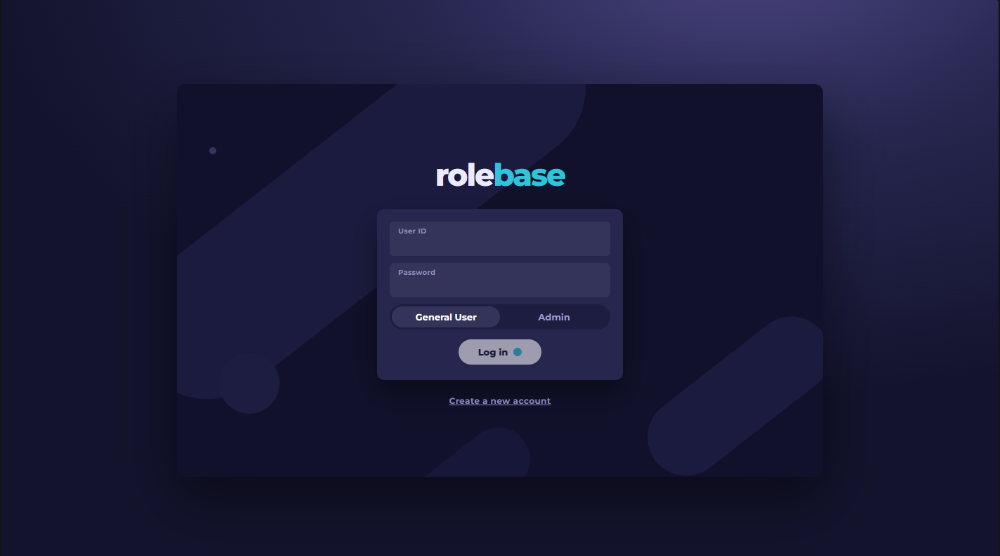
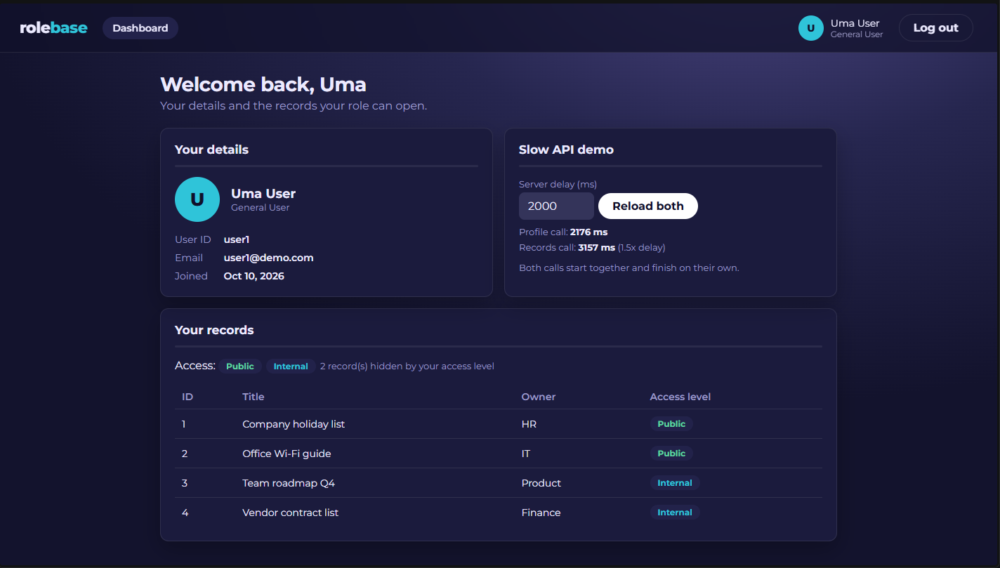
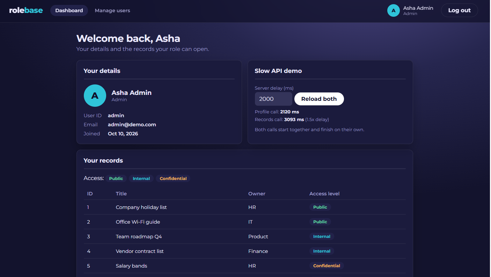

# Rolebase (Angular 20 + Node/TypeScript)

  ## Screenshots
  
  
  

## Run
- API:    `cd server && npm install && npm run dev`   (http://localhost:3000)
- Client: `cd client && npm install && npm start`     (http://localhost:4200)
- Needs Node 20.19+, 22.12+ or 24.

## Logins (created automatically on first API start)
| Role         | User ID | Password |
|--------------|---------|----------|
| Admin        | admin   | admin123 |
| General User | user1   | user123  |

- Pick the same role on the login page as the account has. A wrong role fails.
- "Create a new account" makes a General User only. Only an Admin can create another Admin (Manage users page).
- Change the demo passwords before sharing the site with anyone.

## Notes
- Users are stored in `server/data/db.json`. Delete it to reset to the two demo users.
- Any API call accepts `?delay=<ms>` (max 10000). The dashboard and Manage users pages have a delay box to demo async loading.
